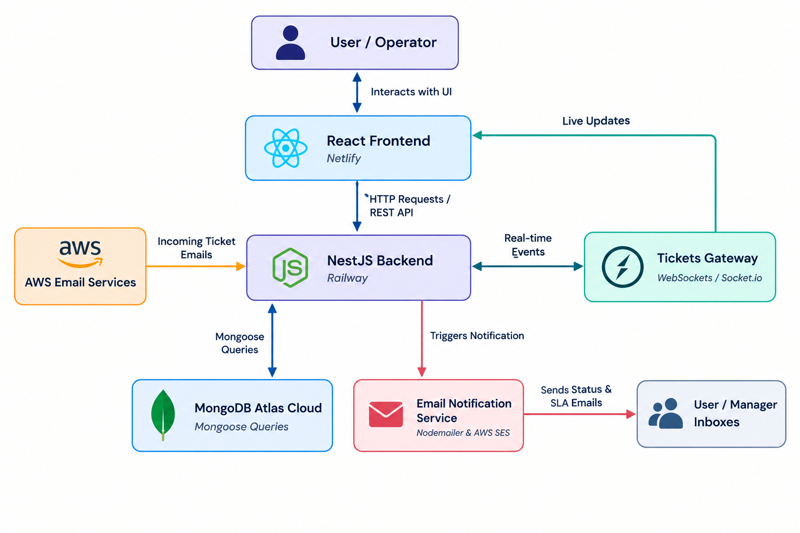
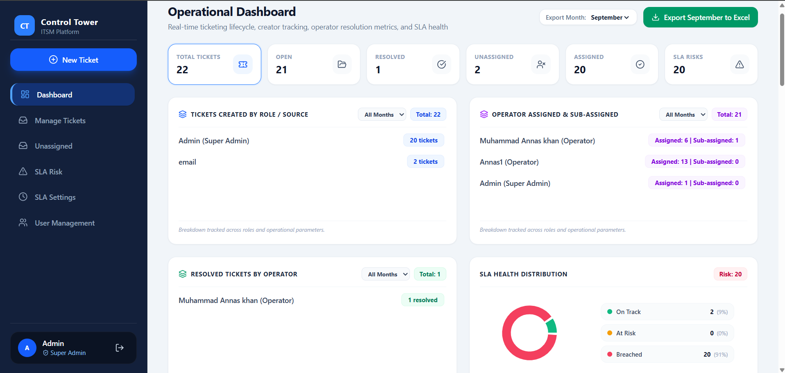
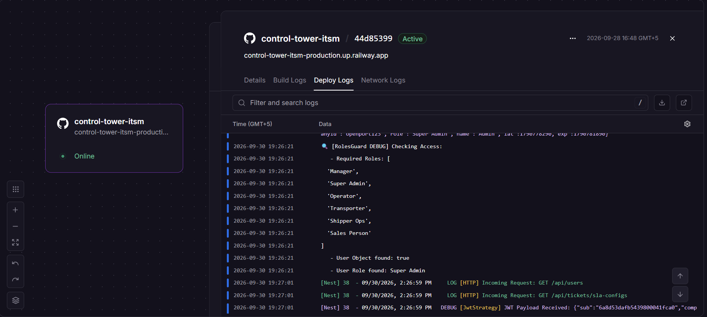
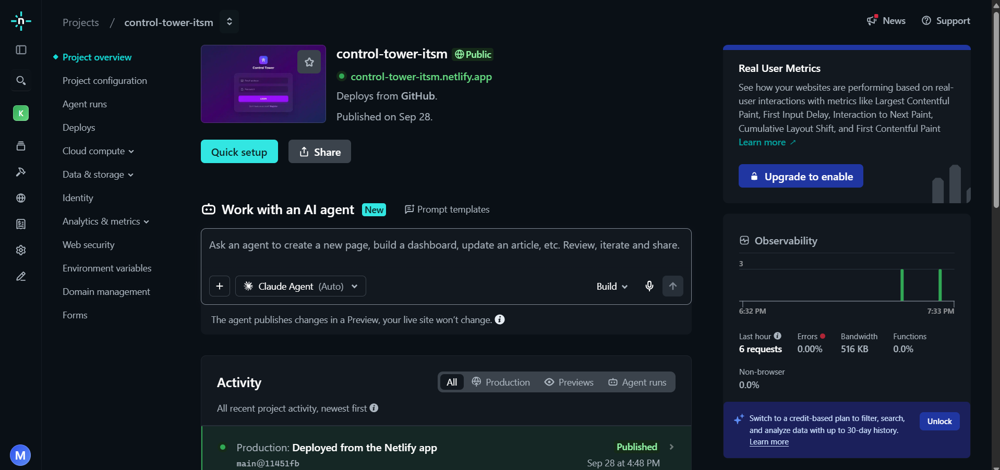

# Control Tower ITSM - Enterprise Ticketing & Operations Platform

An enterprise-grade IT Service Management (ITSM) and operations platform built to streamline ticket lifecycles, automated notifications, SLA monitoring, and real-time dashboard analytics.

---

## 🚀 Tech Stack and Deployment Architecture

* **Frontend**: React (Deployed on **Netlify**)
* **Backend**: NestJS and REST APIs (deployed on **Railway**)
* **Database**: MongoDB Atlas Cloud
* **Services**: AWS Email Services
* **AI Acceleration**: Used Gemini prompt engineering to refine API design, structure complex database queries, and accelerate overall project implementation.

---

## 🌟 Core Features

* **Role-Based Authentication & User Management**: Custom login & registration interface with secure access controls and active session tracking.
* **Smart Ticket Creation & Management**: Advanced multi-criteria sorting, category filtering, and status workflows to optimize operations.
* **Automated Email Ingestion**: Seamless automated ticket creation from incoming user emails utilizing AWS Services.
* **SLA Configuration and Real-Time Deadlines**: Dynamic SLA engine with real-time deadline countdowns to maintain high operational reliability.
* **Live Operational Dashboards**: Real-time analytics view providing complete visibility over system metrics and response times.

---

## 🔄 System Flow Diagram




### 1. Live Operational Dashboard

* **Description**: Real-time analytics view providing complete visibility over system metrics and response times.

### 2. SLA Configuration Panel

* **Description**: Dynamic configuration interface for setting category-based SLAs and priority thresholds.

### 3. Login & Authentication Screen

* **Description**: Secure custom login and registration interface featuring role-based access controls and active session tracking.

### 4. Cloud Deployments & Infrastructure




* **Description**: Overview of cloud services showing the backend deployed on Railway, the frontend on Netlify, and MongoDB Atlas.


## 🛠️ Installation & Quick Start

1. **Clone the repository**:
   ```bash
   git clone [https://github.com/your-username/control-tower-itsm.git](https://github.com/your-username/control-tower-itsm.git)
   cd control-tower-itsm


   Install Dependencies:

Bash
# Backend setup
cd backend
npm install

# Frontend setup
cd ../frontend
npm install

Configure Environment Variables:
Create a .env file in your backend directory containing your MongoDB Atlas connection string, JWT secrets, and AWS/SMTP credentials.

Run the Application:

Bash
# Run backend
npm run start:dev

# Run frontend
npm run dev


👤 Author
Muhammad Annas Khan

Software Engineering Student | Full-Stack MERN Developer
